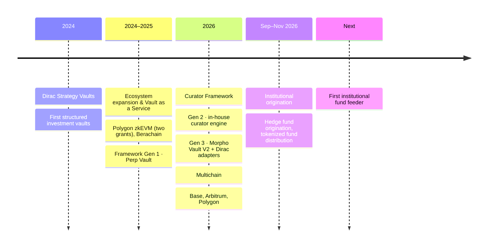

# Dirac Finance
**Where institutional strategies meet onchain distribution.**

Dirac originates strategies from asset managers and hedge funds, distributes them through onchain and TradFi channels, and builds financing backed by tokenized fund shares.

[Website](https://dirac.finance) · [Docs](https://dirac-finance.gitbook.io/dirac-finance) · [2024 thesis](https://medium.com/@DiracFinance/defi-tradfi-synergy-a-defi-new-narrative-cd0236db12aa)

## Our path
One thesis since 2024: bringing TradFi strategies and capital onchain.

## How our vault framework evolved
Each generation answered a limit of the previous one.

| Generation | Approach | Why we moved on | Repository |
|---|---|---|---|
| **Gen 3 · Curator Framework** *(live)* | Canonical Morpho Vault V2, unmodified. Dirac builds the adapters (ERC-4626, Midas RWA, Aave V3, tokenized funds) and the deployment layer | — | `dirac-vault-v2` · publication in progress |
| Gen 2 · Dirac Curator | In-house curator system: allowlisted strategies, lending/perp/swap adapters, risk policies | Maintaining our own vault engine vs. building on an audited standard | Private archive |
| Gen 1 · Perp Vault | Leveraged ERC-4626 vault on Berachain: Dolomite + Kodiak + Orderly, then modular vaults | Single-strategy and single-chain; needed curation and composability | Private archive |

## Start here
- **[dirac.finance](https://dirac.finance)**: strategies, vault configuration and preview vaults
- **[Docs](https://dirac-finance.gitbook.io/dirac-finance)**: architecture, roles, risk model
